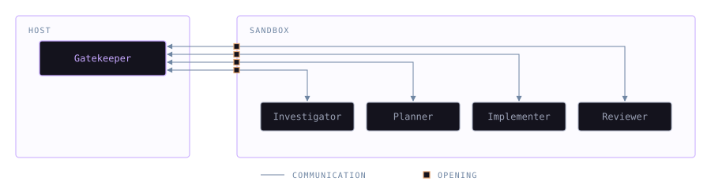
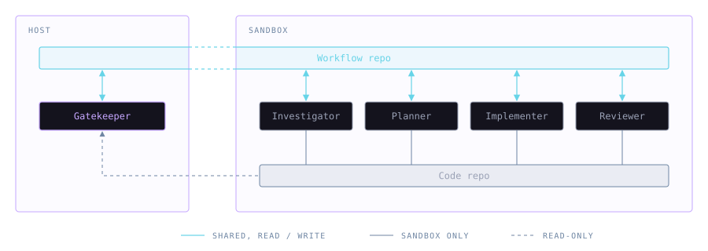
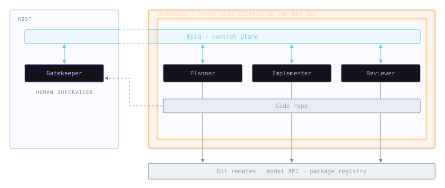

Recent incidents [possibly involving rogue agents](https://www.euronews.com/2026/10/14/entire-swedish-reality-show-season-lost-weeks-before-premiere-amid-disputed-ai-claims) highlight the importance of sandboxing. A common setup is a privileged gatekeeper agent on your host machine whose sole responsibility is to delegate work to restricted peers in sandboxed containers.

This is not watertight, and as the saying goes: if there is a way in, there is a way out, as we shall soon see. In any case, it is better than nothing at all, and most importantly it narrows the contact surface with the outside world.

## It's political

It also makes interactions with the sandboxed agents a pain. Agents without a way to communicate with peers, the gatekeeper, or humans are impractical. The common solution is to relax restrictions with tooling whitelists. This is not only an annoyance from a technical standpoint. In a large corporation, it takes real political skill to navigate security departments and corporate machinery.

## Repo-native tooling

A way around this is repo-native tooling. Tools that work offline with only Git access have most of the allowances in place, as agents need Git anyway to deliver code.

If, for instance, the control plane is part of the repository, we need fewer gates to the outside. We can use Git as a communication transport and a plain log in a repository as memory persistence.

## Trusted channels are soft spots

Now, the sandbox itself is typically not what fails, but [the doors left open on purpose](https://labs.cloudsecurityalliance.org/research/csa-research-note-ai-coding-agent-sandbox-escapes-20260722-c/). Think of it as a drug lord in prison - the cartel is just as lethal as long as he can slip out notes to someone able to act on them, no matter how restricted he is.

Repo-native, Git-based tooling narrows the contact surface with the outside, but it does not limit information flow. An important question is who is reached by what information, with what privileges.

## The Lethal Trifecta

The combination of _private data_, _a way out_, and _untrusted content_ is called [the Lethal Trifecta](https://cosmonic.com/ai-sandbox/principles/lethal-trifecta/). We can contain risk by cutting off one of its three legs.

Sandboxed agents never see secrets, so they lack private data. The gatekeeper does hold secrets, has a way out, and reads what sandboxed agents write, so it is supervised by a human, runs in manual mode and never executes commands.

## Dead drop

Separating the workflow repository from the code repositories keeps the host away from code writes. [Epiq](https://ljtn.github.io/epiq/) is an issue tracker and workflow manager that can operate as the control plane in this way.

It persists an event log in your repo and can track work in other repositories, from a repository with or without a remote, online or offline.

The gatekeeper, with no write access to the code, puts notes in the dedicated workflow repo. The notes are picked up by sandboxed agents, with code write access. Think of a Cold War [dead drop](https://en.wikipedia.org/wiki/Dead_drop). In return, sandboxed agents drop notes back onto the workflow repository, read as untrusted content, leaving an audit trail behind.

## Bare clones

Git itself can be used in clever ways by attackers. [GitSpawn](https://adversa.ai/blog/top-ai-coding-agent-security-resources-october-2026/) used repository config to run code whenever Git was called.

When Epiq links another repository, it reads it through a shallow, bare clone: no working tree, nothing checked out, hooks and `.gitattributes` switched off. Git only ever transfers content, never settings or hooks, so nothing the sandbox writes to a linked repository can make the host run anything.

## A recent setup
A setup I am currently running looks something like this:

I use [OpenShell](https://github.com/NVIDIA/OpenShell) to run sandboxed agents, keeping secrets out of the sandbox entirely, since they are appended by a proxy layer on requests leaving the sandbox.

Epiq works as the control plane in a separate repository, providing a way for agents to interact in a traceable way, and a way for humans to audit agent interactions.

One future improvement, since the communication is passive (text rather than executed commands), is that we could involve audit agents before information is relayed to agents with privileges.

Note: Since agents can write to the workflow repo, it's wise to protect its branch against force-pushes and deletion.

## Composable, sandboxable
Building blocks that are repo-native, standalone and distributed allow you to compose a great variety of setups, depending on organizational needs. Epiq can be used as an agent memory graph, a workflow manager, an audit trail, or all at once.

---

Is a repo-native control plane the right way to run sandboxed agents? I'd like to hear your thoughts, or other setups, in the comments.
