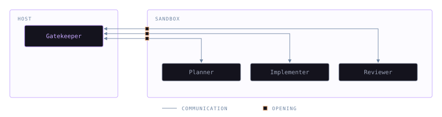
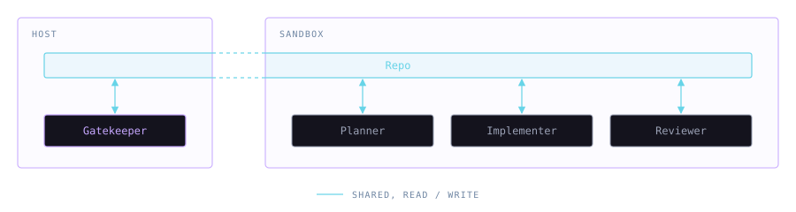
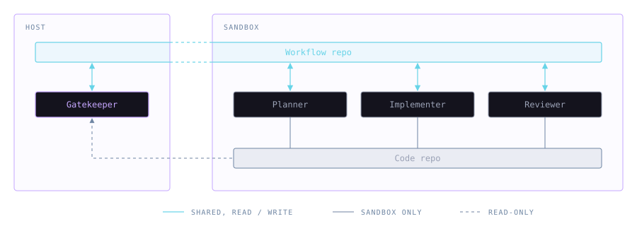
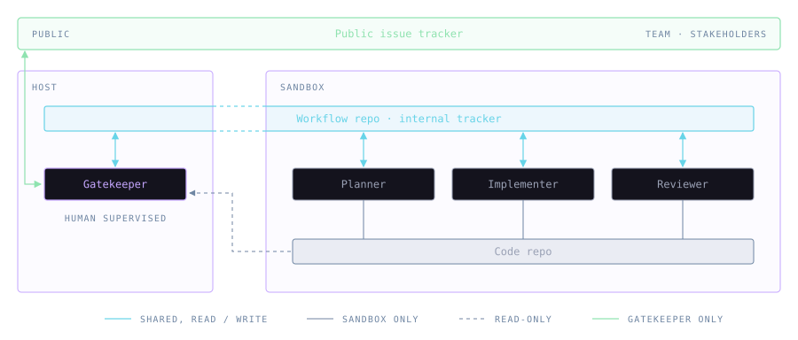
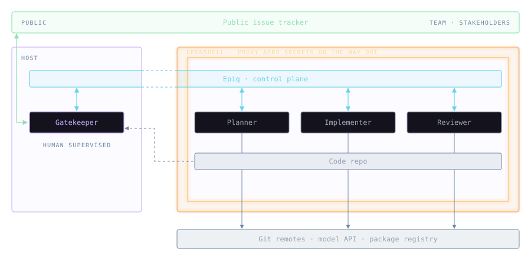

Recent incidents [possibly involving rogue agents](https://www.euronews.com/2026/10/14/entire-swedish-reality-show-season-lost-weeks-before-premiere-amid-disputed-ai-claims) highlight the importance of sandboxing. A common setup is a privileged gatekeeper agent on your host machine whose sole responsibility is to delegate work to restricted peers in sandboxed containers.

This is not watertight, and as the saying goes: if there is a way in, there is a way out, as we shall see. In any case, it is better than nothing at all, and most importantly it narrows the contact surface with the outside world.

## It's political

It also makes interactions with the sandboxed agents a pain. Agents without a way to communicate with peers, the sandbox gatekeeper, or humans are impractical. The common solution is to relax restrictions with tooling whitelists. But this is not only an annoyance from a technical standpoint. In a large corporation, it takes real political skill to navigate security departments and corporate machinery.

## Repo-native tooling

A way around this is _repo-native tooling_ - tools that work offline with only Git access. They have most of the allowances in place, as agents need Git anyway to deliver code.

If, for instance, the agent control plane is part of the repository, we need fewer gates to the outside. We can use Git as a communication transport and a plain log in a repository as memory persistence.

This simplifies our setup, but there is a problem: our gatekeeper, with access to the outside, also has access to the code. This is a security risk. In fact, the sandbox itself is typically not what fails, but [the doors left open on purpose](https://labs.cloudsecurityalliance.org/research/csa-research-note-ai-coding-agent-sandbox-escapes-20260722-c/).

To address this we can split the control plane into a workflow repo, and only give the gatekeeper read access to the code.

## Slipping notes under bars

Repo-native, Git-based tooling does not limit information flow. An important question is who is reached by what information, with what privileges.

Think of it as a drug lord in prison - the cartel is just as lethal as long as he can slip out notes to someone able to act on them, no matter how restricted he is.

The combination of _private data_, _a way out_, and _untrusted content_ is called [the Lethal Trifecta](https://cosmonic.com/ai-sandbox/principles/lethal-trifecta/).

The idea is that we can contain the risk by not giving any agent all three components.

In our setup the gatekeeper is the only agent that holds all three legs. It has secrets, it has a way out, and it reads untrusted agent notes. As such, we need to make it _human supervised_.

Our current model still carries some risk: should external stakeholders get access to the control plane, their input would reach the agents unfiltered, and vice versa. We can stop our drug lord from slipping notes to the outside by adding a public issue tracker alongside the internal issue tracker:

## Dead drop
Now the gatekeeper, with no write access to the code, reads instructions from stakeholders and puts notes in the dedicated workflow repo. The notes are picked up by sandboxed agents, with code write access. Think of a Cold War [dead drop](https://en.wikipedia.org/wiki/Dead_drop). In return, sandboxed agents drop notes back onto the workflow repository, leaving an audit trail behind. The gatekeeper reads them as untrusted content.

This is starting to look a whole lot like a setup I am running. For me [Epiq](https://epiq.sh/) is the internal issue tracker and workflow manager operating as the _control plane_. It persists an event log in your repo and can track work in other repositories, online or offline. It gives me a way to peek into the machinery of the sandbox, and I can also time-travel via the timeline scrubber and inspect historical workflows.

## Bunch of colored boxes

Now, we can make this even more colorful. If we use something like [OpenShell](https://github.com/NVIDIA/OpenShell) to run sandboxed agents, we can keep secrets out of the sandbox entirely, since they are appended by a proxy layer on requests leaving the sandbox.

This is a lot of colored boxes, so let's not dive deeper. I think this is sufficient to illustrate a basic setup that addresses problems with the lethal trifecta, only requiring: a _Git repo_, _a sandbox_ (OpenShell), and _a memory graph_ (Epiq).

## Conclusion - repo-native is composable and sandboxable
Using tooling primitives that are repo-native, standalone and distributed allows you to compose a range of setups, depending on organizational needs. Epiq can manage one, or both, of the two workflow management planes.

Agentic workflows weren't on the radar at the inception of Epiq, 1.5 years ago, but an append-only event log that lives in the repo and travels over Git turns out to integrate easily with sandboxes, providing a way to coordinate without opening another gap in the wall.

---

Is repo-native tooling a great solution to sandbox restrictions? Share your thoughts in the comments below.
