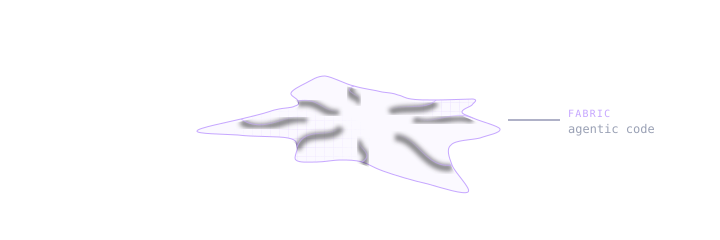
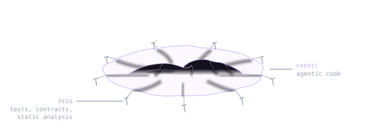
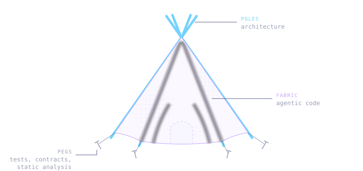

Agentic code can be thought of as a fabric. It is easily shaped and can assume any form with little effort, but it is hard to build something rigid out of it. While agents can produce brilliant snippets of code at the level of human experts, cohesion and consistency remain a challenge.

## The peg fallacy
There is a real problem with the softness of fabric alone. A natural inclination is to address the lack of structure in agentic workflows by adding tests, contracts, static analysis and agent harnesses. However, pinning down the edges with pegs does little to enforce internal structural rigidity. Without an internal structure to apply the constraining forces upon we are still in a soft, flat mess.

## Building a tipi
We'd be helped by sturdy poles to stretch the fabric into its desired shape. In software terms - a distinct architecture by which all additional work is guided and upon which the tests and static analysis apply constraining forces. In a tent, there is a symbiotic relationship between the internal structure, the fabric and the pegs. Software is much the same. Without an architecture to stretch the web of features across, the constraining pegs are of little use. Without the pegs, on the other hand, we might wake up in the morning with all of the wooden structure in place, but the fabric in a tree top far away.

That's the theory. Here is how it played out on my project.

## Picking the poles
In the early summer of 2025 I started building Epiq, an issue tracker that keeps its state in the repository and syncs over Git. The architecture was shaped by manual struggle with the code, rubber ducking, and long road trips spent thinking it through.

Trees in the forest of ideas were selected, pruned of false branches, logged, sharpened, and finally knit together. In the end, a few non-negotiable architectural poles emerged:

- User-scoped, append only event logs for persistence
- Events with [CRDT](https://en.wikipedia.org/wiki/Conflict-free_replicated_data_type)-like properties, only referencing shared history
- Causal order resolution, tie-broken by ULID

Upon these rests every later feature.

## Constraints over slop
None of these is exotic on its own, but together they are not a mainstream solution. They follow from the constraints:

- Git is the only transport
- Users are never asked to resolve merge conflicts
- Several people, and agents, might edit at the same time, on- or offline

These constraints were derived from a human vision. Without one, agents drift. This is why, when you ask for a red button and then a blue one, you may get two button components rather than one configurable button.

## Pinning it down

With the poles in place after launch in summer 2026, a fabric factory opened its gates a meter away, enter Claude Code. Any earlier, it might have been to the detriment of the architecture. As it was, it arrived at the precise moment when a fabric of features had a frame to stretch across.

Suddenly not only were features cheap, but tests too. You could add a thousand tent pegs for a single pole, pinning it firmly to the ground. The core is now pegged down with tests trying to break the concurrency model or the Git interactions. There is a test simulating a team of 20 using the tracker intensely every day for 10 years, ensuring responsiveness at scale.

Pegs are now cheap, allowing us to lock the architecture firmly in place.

## The great inversion
The observant reader might have noticed that there is a common denominator between all of the foundational poles. They are all concerned with the data model.

A common notion is that data is soft and software is rigid. Agentic workflows have challenged, one might even say, inverted, this perceived relationship. What has not changed, however, is the cementing effect data has on a system. Data comes with migrations, uncharted sources, varying quality, risky transformations, all of which are petrifying to system evolution.

Picking the right data model is not an afterthought but a core feature of the architecture. Poles to stretch the soft fabric of code across.

On this project, the data model has proven essential for distributed live collaboration, and has made the system evolvable. New features were added by deriving information from the logs or by adding another event type, rather than by migrating existing data. Adding image attachments, for instance, meant one new event type, which newer clients recognized and older ones ignored.

One can expect the data model to outlive the code, and as such it must be considered part of the load-bearing structure.

## The aimless factory
Massive effort goes into setting up harnesses and software factories. In the real world there are factories that overproduce to justify their existence because they are static, massive units built for predicted demand that never materialized, producing high-quality garbage that no one asked for. This can happen in software too. Vision, intention, and comprehension are still key to providing value to users.

## Back to the tipi
Agentic workflows can help us wrap up our framing in beautiful ornaments in no time and help us pin it firmly to the ground with a thousand pegs, but without well-understood, sturdy poles of architecture, we have nothing but a soft, formless mess. Ornate, but flat, wet and tangled.

Does this resonate with you, or do you disagree? Please share your thoughts below.
